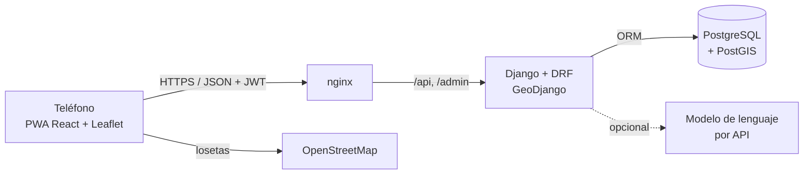

# Mapa Comunitario de Puntos de Carga

Plataforma colaborativa para encontrar, desde el teléfono, **qué lugares cercanos tienen corriente ahora mismo** para cargar equipos durante los apagones. La comunidad publica puntos (negocios, instituciones, espacios públicos y viviendas voluntarias) y confirma su estado con un solo toque.

> Zona piloto: centro de Santa Clara, Cuba. El objetivo del piloto (6 semanas) es medir si la comunidad mantiene el mapa vivo.


## Qué hace

| Flujo | Para quién | Qué pasa |
|---|---|---|
| **1. Encontrar dónde cargar** | Persona con apagón | El mapa se centra en su ubicación, filtra "con energía ahora", abre la ficha ("confirmado hace 12 min") y pulsa *Cómo llegar*. |
| **2. Compartir un punto** | Anfitrión | Coloca el pin, rellena tomas, horario y acceso. Si es vivienda, se muestra con ubicación aproximada. Queda *pendiente de revisión*. |
| **3. Confirmar el estado** | Comunidad | "¿Hay corriente ahora?" → con energía / sin energía / lleno / cerrado. Un toque. Sube la reputación. |
| **4. Moderar** | Moderador | Panel con la cola de pendientes y denuncias: aprobar, ocultar o pedir correcciones. Cada acción queda registrada. |
| **Extra: alta asistida con IA** | Anfitrión | Pega un mensaje libre y recibe un borrador con los campos. Nada se publica sin su confirmación. |

La regla central: **el estado actual no se guarda, se calcula**. Es el último reporte de las últimas 3 horas. Si no hay ninguno, el punto aparece como **"sin confirmar"**, nunca como "con energía".

## Arquitectura



| Bloque | Tecnología | Responsabilidad |
|---|---|---|
| Frontend | React + Vite (PWA), Leaflet + OpenStreetMap | Mapa con filtros, ficha, formularios. Móvil primero. Caché para conexión débil. |
| Backend | Django + Django REST Framework + GeoDjango | API REST, JWT, permisos, consultas por cercanía, estado vigente, reputación, moderación. |
| Base de datos | PostgreSQL + PostGIS | Seis tablas; índice espacial GiST para "puntos a menos de 1 km". |
| IA (opcional) | LLM por API desde el backend + heurísticas locales | Borrador a partir de texto libre, detección de duplicados y spam. **La IA propone; una persona confirma.** |

Más detalle en [`docs/ARQUITECTURA.md`](docs/ARQUITECTURA.md).

## Puesta en marcha

### Opción A · Docker (todo en un comando)

```bash
cp .env.example .env
docker compose up --build
docker compose exec backend python manage.py sembrar_demo   # 15 puntos de ejemplo
```

Abre <http://localhost:8080>. Panel de moderación: <http://localhost:8080/admin/>.

### Opción B · En local, para desarrollar

Requisitos: Python 3.12+, Node 22+, PostgreSQL 16 con PostGIS y GDAL instalados.

```bash
# Base de datos
createdb puntos && psql -d puntos -c "CREATE EXTENSION postgis;"

# Backend  (http://localhost:8000)
cd backend
python -m venv .venv && source .venv/bin/activate
pip install -r requirements-dev.txt
python manage.py migrate
python manage.py sembrar_demo
python manage.py runserver

# Frontend (http://localhost:5173), en otra terminal
cd frontend
npm install
npm run dev
```

### Usuarios de demo

Contraseña de todos: `Demo1234!`

| Email | Rol | Para qué |
|---|---|---|
| `admin@demo.local` | Administrador | Todo, incluido borrar. |
| `moderador@demo.local` | Moderador | Entra al panel `/admin/` y modera. |
| `ana@demo.local` | Usuaria de confianza (reputación 25) | Publica puntos sin revisión. |
| `luis@demo.local` | Usuario nuevo (reputación 3) | Sus puntos pasan por revisión. |

## API

| Método | Ruta | Descripción |
|---|---|---|
| GET | `/api/puntos/?lat=&lng=&radio_km=&con_energia=1&abierto_ahora=1&tipo=&min_tomas=` | Puntos del mapa con estado calculado |
| GET | `/api/puntos/{id}/` | Ficha |
| POST / PATCH / DELETE | `/api/puntos/` · `/api/puntos/{id}/` | Alta, edición y retirada (dueño) |
| GET | `/api/puntos/mios/` | Mis puntos y su estado de publicación |
| POST | `/api/puntos/{id}/pausar/` | Pausar o reanudar (anfitrión) |
| POST | `/api/puntos/{id}/contacto/` | Contacto bajo solicitud (registrados, con límite) |
| POST / DELETE | `/api/puntos/{id}/favorito/` · GET `/api/favoritos/` | Favoritos |
| GET / POST | `/api/puntos/{id}/reportes/` | Reportes de estado (flujo 3) |
| POST | `/api/denuncias/` | Denunciar punto o reporte |
| GET | `/api/metricas/` | Métricas del piloto (moderadores) |
| POST | `/api/ia/borrador/` | Borrador con IA (si `IA_HABILITADA=True`) |
| POST | `/api/auth/registro/` · `/token/` · `/token/refresh/` · `/logout/` · GET `/yo/` | Autenticación JWT |

## Calidad

```bash
cd backend && pytest          # 70 pruebas: estado vigente, PostGIS, permisos, privacidad, EXIF, IA...
cd backend && ruff check .    # estilo
cd frontend && npm run lint && npm run build
cd frontend && npx playwright test   # flujo completo (necesita el backend con datos de demo)
```

GitHub Actions ejecuta todo esto en cada cambio, además de `pip-audit` y `npm audit`. Dependabot propone actualizaciones semanales.

## Hoja de ruta

| Fase | Contenido |
|---|---|
| **MVP** (este repositorio) | Mapa con filtros, alta de puntos, reporte en un toque, moderación, PWA con caché. La IA existe pero va desactivada. |
| **Fase 2** | Alta asistida con IA activada, avisos sobre favoritos, bot de Telegram sobre la misma API. |
| **Fase 3** | Estadísticas por zona, panel para organizaciones aliadas, nuevas zonas, estimación de disponibilidad por historial. |

## Documentación

- [`docs/ARQUITECTURA.md`](docs/ARQUITECTURA.md): esquema de datos, decisiones técnicas, seguridad.
- [`docs/GUIA_DEL_CODIGO.md`](docs/GUIA_DEL_CODIGO.md): dónde está cada cosa y cómo funciona, sección por sección.
- [`docs/DEMO.md`](docs/DEMO.md): guion del demo, preparación y plan B.

## Licencia

Pendiente de definir.
