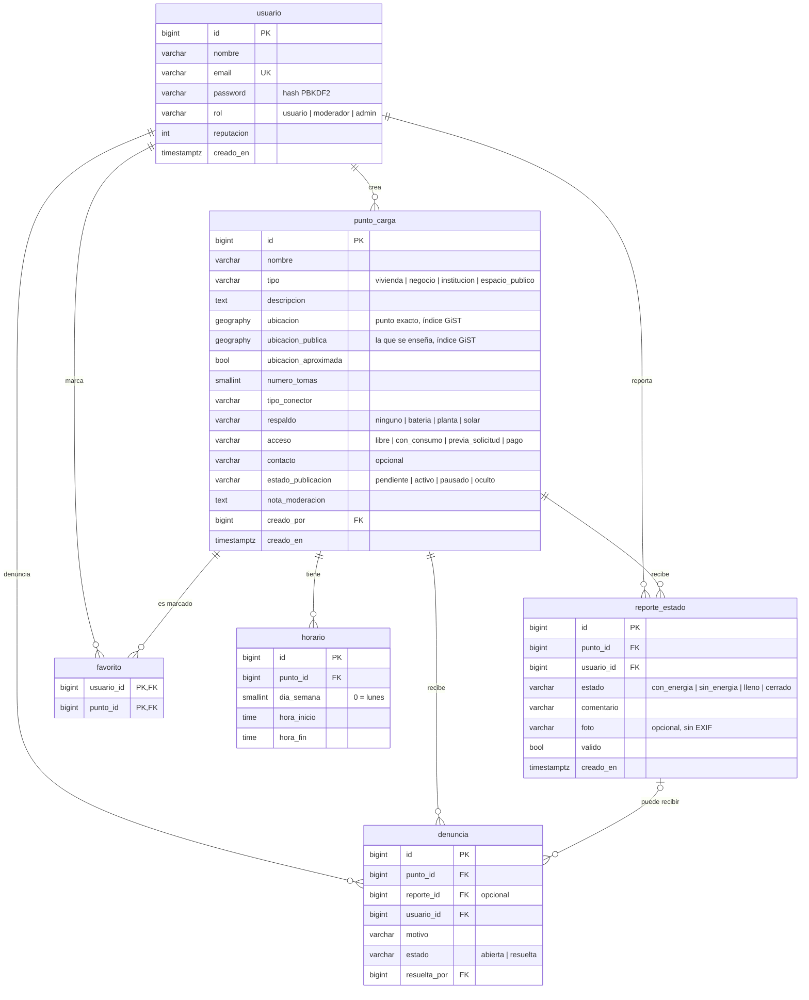

# Arquitectura

## Por qué frontend + API + base de datos

El problema es, en esencia, **publicar datos con ubicación y consultarlos desde cualquier teléfono**.

- **Alcance sin instalar nada.** Una PWA abre en cualquier navegador; no dependemos de tiendas de aplicaciones.
- **Datos compartidos.** Una base central: el reporte de una persona lo ve toda la comunidad al instante.
- **Las reglas viven en un solo sitio.** La API valida, aplica permisos y modera. Un bot de Telegram o una app móvil usarían la misma API.
- **Cada capa evoluciona por separado.** Cambiar el mapa no obliga a tocar la base de datos.
- **Costo bajo.** Monolito modular: un despliegue, sin microservicios.

## Monolito modular: las apps de Django

```
backend/
├── config/            settings, urls (un solo punto de entrada /api/)
└── apps/
    ├── usuarios/      tabla usuario, roles, reputación, registro y JWT
    ├── puntos/        punto_carga, horario, favorito; búsqueda por radio; panel de moderación
    ├── reportes/      reporte_estado; CÁLCULO DEL ESTADO ACTUAL; fotos sin EXIF
    ├── moderacion/    denuncia; acciones de moderación con registro; métricas
    └── ia/            borrador desde texto libre; detector de duplicados y spam
```

Cada app tiene la misma forma: `models.py` (tablas) → `services.py` (lógica de negocio, sin HTTP) → `serializers.py` (validación y JSON) → `views.py` (endpoints) → `admin.py` (panel). La lógica en `services.py` se prueba directamente, sin pasar por la API.

## Esquema de datos



### Campos añadidos al esquema del documento, y por qué

| Campo | Motivo |
|---|---|
| `punto_carga.ubicacion_publica` | En viviendas, la ubicación se ajusta a una rejilla de ~200 m. Las consultas públicas filtran **por esta columna**, así no se puede deducir la casa moviendo el centro de búsqueda. |
| `punto_carga.nota_moderacion` | El moderador pide correcciones con una nota; el detector deja aquí sus avisos ("posible duplicado"). |
| `estado_publicacion = pausado` | El anfitrión puede pausar su punto en cualquier momento sin perderlo. |
| `reporte_estado.valido` | Si se acepta una denuncia contra un reporte, deja de contar pero queda el rastro. |
| `denuncia.detalle` | Texto libre opcional para explicar la denuncia. |

### El estado actual se calcula

`apps/reportes/services.py` → `anotar_estado_actual()` añade a cada punto, **en una sola consulta SQL** (subconsulta correlacionada), el último reporte que cumpla:

1. `valido = True`
2. `creado_en >= ahora − 3 h` (configurable con `VENTANA_VALIDEZ_HORAS`)
3. el autor tiene reputación `>= REPUTACION_MINIMA_REPORTE` (0)

Si no hay ninguno: `sin_confirmar`. Así un dato viejo nunca se muestra como cierto, y el daño de un reporte falso dura como mucho 3 horas.

### Consultas por cercanía

`ubicacion_publica__dwithin=(centro, D(km=radio))` se traduce a `ST_DWithin` de PostGIS sobre un campo `geography` (distancias en metros reales) y usa el índice GiST. Sin el índice, la base revisaría todos los puntos; con él, solo los de la zona.

## Decisiones técnicas

| Decisión | Elección | Por qué |
|---|---|---|
| Cliente | React + Vite como PWA | Un solo código para cualquier teléfono; instalable; caché cuando la conexión falla. |
| Mapa | Leaflet + OpenStreetMap | Gratis, sin clave ni cuota. Google Maps descartado por costo y cuotas. URL de losetas configurable (`VITE_TILES_URL`) por si hace falta un proveedor propio en producción. |
| Backend | Django + DRF | ORM, panel de administración que sirve de herramienta de moderación, autenticación y permisos maduros. |
| Base de datos | PostgreSQL + PostGIS | Consultas por radio con índice espacial. |
| Autenticación | JWT de 15 min + refresco de 7 días con rotación y lista negra | Sin sesiones en servidor; encaja con una PWA. |
| Estructura | Monolito modular | Un equipo pequeño, un despliegue. Se separa solo si la carga lo justifica. |
| IA | LLM por API desde el backend | La clave nunca llega al navegador; la salida pasa por el mismo serializador que el alta normal. |
| Entrega | Docker + GitHub Actions | Entornos reproducibles, pruebas en cada cambio. |

## Funcionamiento sin conexión

| Qué | Cómo |
|---|---|
| Losetas del mapa | Service worker con estrategia *CacheFirst* (hasta 800 losetas, 30 días). |
| Última consulta | *NetworkFirst* en el service worker + copia en `localStorage` con su hora: "sin conexión, datos de las 14:05". |
| Reportes | Si no hay red, se guardan en una cola local y se envían al volver la señal (evento `online`). Las fotos no se encolan. |

## Seguridad

| Riesgo | Medida | Dónde |
|---|---|---|
| Robo de credenciales | Hash PBKDF2 de Django, HTTPS + HSTS en producción, tokens cortos | `settings.py` |
| Acceso indebido | Permisos por rol y por objeto (dueño / moderador / admin) | `puntos/permissions.py`, `moderacion/admin_base.py` |
| Abuso | Límites de peticiones por IP y por usuario, por acción (reportes 20/h, puntos 10/día...) | `REST_FRAMEWORK.DEFAULT_THROTTLE_RATES` |
| Fuerza bruta | Límite de 10 intentos/min en login y registro | `usuarios/views.py` |
| Inyección SQL | Todas las consultas por el ORM | — |
| XSS | React escapa todo lo que pinta; nunca se usa `dangerouslySetInnerHTML` | — |
| Fotos | Se abre la imagen para validar el tipo real, se limita tamaño y píxeles, se recodifica y se **eliminan los EXIF** (GPS) | `reportes/imagenes.py` |
| Privacidad | Ubicación aproximada en viviendas, contacto solo bajo solicitud, la ubicación de quien consulta no se guarda | `puntos/models.py`, `puntos/views.py` |
| Secretos | Variables de entorno; `.env` fuera del repositorio | `.env.example` |
| Datos al servicio de IA | Se ocultan teléfonos y correos antes de enviar el texto | `ia/extractor.py` |
| Dependencias | `pip-audit`, `npm audit` en CI y Dependabot | `.github/` |
| Pérdida de datos | Copias periódicas (`pg_dump`) y prueba de restauración — ver abajo | — |

Copias de seguridad en el servidor (ejemplo con cron diario):

```bash
docker compose exec -T db pg_dump -U puntos -Fc puntos > backup_$(date +%F).dump
# Restaurar (probarlo de vez en cuando en otra base):
docker compose exec -T db pg_restore -U puntos -d puntos_prueba < backup_2026-11-15.dump
```

Pendiente para después del MVP: captcha si se detecta actividad anómala.
